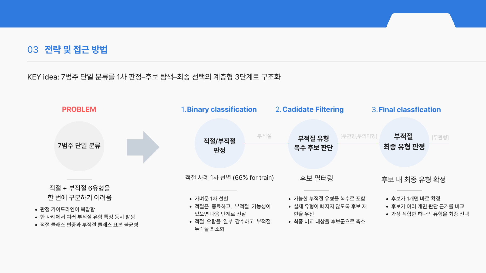

# ALTogether
## 사례 기반 판정 가이드라인 생성과 계층형 추론을 결합한 한국어 대체텍스트 품질 판정

Gemma 4 31B 기반 로컬 멀티모달 에이전트로 한국어 대체텍스트의 품질을 판정합니다. 적절성 판단 → 오류 유형 복수 후보 탐색 → 최종 유형 선택의 세 단계로 구성합니다.

클래스 불균형과 희소 유형으로 학습 사례가 부족한 상황에서, 틀린 사례를 통해 **다음 문제에서도 사용할 판단 기준**을 만드는 데 집중했습니다. Train에서는 놓친 기준을 단계별 가이드라인으로 축적합니다. 실제 사용 단계인 Frozen에서는 **여러 차례의 비교 실험과 인간 검토를 거쳐 선정한 가이드라인 3개를 고정**하고, 필요한 사례에만 피드백과 재판정을 수행합니다.



위 도식과 방법론 설명서의 Train·Test 도식은 참가팀 발표자료에서 가져왔습니다.

### 주요 자료

1. [문제해결 방법 설명서](docs/문제해결_방법론.html) ([Markdown](docs/문제해결_방법론.md)): 개요, 데이터, 구체적 방법, 실험·평가, 기대효과.
2. [실행 Notebook](notebooks/01_ALTogether_학습과추론.ipynb): CPU에서 실행 가능한 데이터·전처리·문서·저장 결과 평가와, GPU Train/Frozen 실행 셀.
3. [실제 사용 예시](demo/README.md): 원본 이미지·alt·메타데이터와 저장된 판정·피드백 결과. 재실행 방법은 Notebook과 아래 실행 절차에 제시합니다.
4. [최종 가이드라인 열람 Notebook](notebooks/02_최종_판정가이드라인.ipynb): **실행 없이 읽을 수 있는 이진·후보·최종 선택 기준 전문**. [브라우저용 문서](docs/최종_판정가이드라인.html)와 [원본 MD 3개](model/guidelines)도 제공합니다.
5. [AI 활용 및 검토 과정](docs/AI활용_및_검토과정.md), [외부 자료·이용조건](docs/외부자료_및_이용조건.md).

### 1. Train과 실제 사용의 구분

| 구분 | Train: 판단 기준 구축 | Frozen: 실제 사용 |
|---|---|---|
| 입력 | 이미지·alt·메타데이터·공식 가이드라인·공개 정답 | 이미지·alt·메타데이터·공식 가이드라인·검토를 마친 단계별 MD |
| 정답 사용 | 단계별 실패 식별과 피드백 생성에 사용 | 모델 입력에 제공하지 않음 |
| 재검토 대상 | 이진 오답 / 정답 후보 누락 / 정답이 후보 안에 있는데 최종 오선택 | 에이전트가 문서와 원본을 비교해 피드백 필요성을 판단 |
| 문서 갱신 | 기존 문서와 새 피드백을 대조해 중복·충돌을 줄여 갱신 | SHA-256으로 확인한 사본을 실행 중 고정 |
| 사람의 역할 | 반복 패턴 검토, 기준 수정, 부작용 확인, 채택·보류 결정 | 근거 확인, 이의 사례 수집, 다음 기준 개정 검토 |
| 최종 산출물 | 이진·후보·최종 선택용 MD 3개, 단계별 판정과 피드백 | 7범주 판정·근거·CSV·단계별 성능 |

여기서 Train은 모델 가중치를 미세조정하는 과정이 아니라 **판단 경험을 문서 형태로 학습하는 과정**입니다. 최종 사용 문서는 자동 생성 초안을 그대로 채택하지 않고, 여러 차례의 사례 대조·회귀 비교·사람의 검토를 거쳐 선정했습니다. 정식 K-fold 교차검증을 수행했다는 의미는 아닙니다.

### 2. 폴더 구성

```text
ALTogether_20261106/
├── README.md
├── requirements.txt                  # 실제 실행 의존성 및 고정 버전
├── data/                             # 대회 공식 Train 2400 / Test 600, 공개 자료
├── model/
│   ├── weights/                      # 공개 가중치 배치 위치·안내 (가중치 미포함)
│   ├── guidelines/                   # 검토를 마친 이진·후보·최종 선택 MD
│   ├── frozen_config.json            # 실제 제출 기반 실행의 프롬프트·설정 스냅샷
│   └── runtime/                      # llama.cpp 빌드 후 실행 파일 배치 위치
├── src/                              # 실제 판정 엔진, 대시보드, 회귀 테스트
├── notebooks/                        # 01 학습·추론·평가 / 02 최종 가이드라인 전문
├── scripts/                          # 설치·Train/Frozen·평가·CSV·실행 점검
├── demo/                             # 실제 입력 이미지·판정 기록·사용 예시
├── figures/                          # 방법론 도식
├── results/                          # 저장된 모델 출력, 공식 제출 CSV·성적 기록
├── docs/                             # 한국어 설명, 환경, 검토 과정, 출처
└── licenses/                         # 외부 구성요소 이용조건
```

공개 사전학습 모델의 가중치는 제출 ZIP에 포함하지 않습니다. **우리가 개발한 문서형 가이드라인 3개와 실행 설정은 포함**합니다. [모델 배치 안내](model/README.md)의 고정 Hugging Face 경로에서 동일한 모델을 받을 수 있습니다. GPU 실행을 위해 모델 다운로드·빌드 공간으로 30GB 이상의 여유 공간을 권장합니다.

### 3. 검증한 HW/SW 환경

| 항목 | 환경 |
|---|---|
| OS | Ubuntu 22.04.4 LTS, Linux x86_64 |
| Python | 3.12.4 |
| GPU | NVIDIA RTX A6000 48GB 중 한 장 사용 |
| NVIDIA Driver / CUDA Toolkit | 570.144 / 12.9.41 |
| llama.cpp | `86b94708f22478f900b76ca02e316f4f3418faff` |
| 모델 | Gemma 4 31B IT, IQ4_NL GGUF + BF16 multimodal projector |
| 실행 설정 | temperature 0, seed 42, 요청 최대 4096 토큰, 슬롯별 문맥 24576, 2슬롯 |
| MD 갱신 | 별도 최대 6144 토큰; 기존 문서가 5000자를 넘으면 별도 정리 프롬프트 |
| 주요 라이브러리 | Streamlit 1.64.0, Pillow 12.3.0, CairoSVG 2.9.1, NumPy 2.3.5, OpenCV 4.10.0.84 |

단일 GPU 로컬 추론이며 외부 상용 AI API나 인증키가 **실행에 필요하지 않습니다**. 48GB GPU·RAM 64GB 이상을 권장합니다. 이미지 크기와 문맥에 따라 사용량·시간이 달라집니다. Windows에서는 Linux 서버 또는 WSL2 + NVIDIA GPU 환경을 사용하십시오. GPU·라이브러리 차이에 따른 수치적 차이는 있을 수 있습니다.

### 4. 환경 구성

패키지 루트에서 실행합니다.

```bash
# Ubuntu 시스템 의존성: 관리자 권한이 있는 설치 담당자가 한 번 실행
sudo apt-get update
sudo apt-get install -y libcairo2 libgl1 libglib2.0-0 libssl3

# Python 3.12와 venv가 준비된 환경
bash scripts/setup.sh
source .venv/bin/activate
python scripts/smoke_test.py
```

GPU 실행 전 CUDA Toolkit과 빌드 도구(`build-essential`, `cmake`, `libssl-dev`, `libcurl4-openssl-dev`)를 설치한 뒤 `bash scripts/build_runtime.sh`로 동봉된 동일 커밋 소스를 빌드하고, `python scripts/download_models.py`로 공개 모델을 내려받습니다. CPU 기반 Notebook·저장 결과 평가는 모델 없이 가능합니다. 상세 내용은 [실행환경](docs/실행환경.md)을 확인하십시오.

### 5. Train: 사례에서 판단 기준 만들기

```bash
# 작은 규모로 실행 흐름 확인. 정답이 있는 train만 사용.
python scripts/workflow.py --mode train --dataset train --limit 5 --gpu 0

# Train 전체로 새 문서 축적
python scripts/workflow.py --mode train --dataset train --gpu 0

# 기존 검토 문서에서 시작해 공개 109건으로 추가 기준 축적
python scripts/workflow.py --mode train --dataset public109 --seed-reviewed --gpu 0
```

출력은 `src/runs/실행_ID/`에 저장됩니다. Train 시작 시 문서를 사본으로 사용하므로 `model/guidelines/`의 최종 문서는 덮어쓰지 않습니다. 사람이 새 MD와 이전 MD를 대조하고, 기존 정답을 오답으로 바꾸는 부작용까지 평가한 뒤 운영에 사용할 버전을 선정합니다.

### 6. Frozen: 선정한 가이드라인으로 실제 판정

```bash
# 최종 가이드라인으로 Test 5건 확인
python scripts/workflow.py --mode frozen --dataset test --limit 5 --gpu 0

# Test 600건 전체
python scripts/workflow.py --mode frozen --dataset test --gpu 0

# 동일 가이드라인을 Train / 공개 109건에 따로 평가
python scripts/workflow.py --mode frozen --dataset train --gpu 0
python scripts/workflow.py --mode frozen --dataset public109 --gpu 0

# 문서 버전을 교체해 비교하려면
python scripts/workflow.py --mode frozen --dataset test --guidelines /경로/검토완료_MD폴더 --gpu 0
```

`--scope binary`는 후보 탐색 전 종료, `--scope candidates`는 후보 탐색 후 종료합니다. 전체 분류의 장식오용형 전용 분기를 포함하려면 기본 `full`을 사용합니다. 중단된 실행은 `python src/run_ocr.py --run src/runs/실행_ID`로 재개합니다.

```bash
# 전체 Test 예측이 성공한 실행에서만 CSV 생성
python scripts/export_csv.py --run src/runs/실행_ID --output results/new_submission.csv
# 대회가 허용한 공개 109건을 반영하려면 --apply-public-labels 추가
```

대시보드 Test CSV 다운로드는 공식 공개 정답을 적용합니다. 모델 원본 결과는 보존되며, CLI에서는 옵션으로 적용 여부를 분리합니다.

### 7. 대시보드와 Notebook

```bash
bash scripts/dashboard.sh
# 실행 http://localhost:8501 / 사례 검토 http://localhost:8502 / 성능 http://localhost:8503
```

Frozen 실행 시 `reviewed_guidelines`를 선택하면 동봉한 최종 문서를 사용합니다. 원격 서버에서는 SSH 포트 전달이 필요합니다. 예: `ssh -N -L 18501:127.0.0.1:8501 사용자@서버` 후 로컬 `http://localhost:18501` 접속.

Notebook은 Python 3.12 커널로 실행합니다. `pip install -r requirements-notebook.txt` 후 `jupyter lab`을 실행하십시오. 기본 셀은 GPU 없이 동작하며, GPU 재추론은 `RUN_TRAIN` / `RUN_FROZEN`을 직접 켰을 때만 시작합니다.

`02_최종_판정가이드라인.ipynb`는 문서를 읽는 용도이므로 커널 실행이나 모델 다운로드가 필요 없습니다. 세 문서를 각각 별도 절로 제시하고, 실제 추론에서 사용하는 원본 MD와 동일한 내용을 넣었습니다.

두 Notebook에는 참가팀 발표자료의 설명 그림을 이미지로 내장했습니다. 01에서는 전체 구조·Train·Frozen 설명 아래에, 02에서는 가이드라인 생성·사용 흐름에 배치하여 그림 파일 경로가 바뀌어도 표시됩니다.

```bash
python scripts/evaluate.py                       # 동봉 Train 결과 재평가
python scripts/evaluate.py --dataset public109   # 동봉 Test 중 공개 109건, 보정 전 모델 출력
PYTHONPATH=src python -m pytest src/tests -q
```

### 8. 성과와 해석

| 구분 | 이진 F1 | 7범주 macro-F1 | 종합 |
|---|---:|---:|---:|
| 공식 제로샷 기준선: 평가 출력이 있는 584건 | 0.7470 | 0.6310 | 0.6890 |
| 대회 제출 결과: 600건, 참가자 전달값 | **0.8265** | **0.7035** | **0.7650** |

종합 = 이진 F1 × 0.5 + 7범주 macro-F1 × 0.5. 표본 범위가 다른 공식 기준선과의 참고 비교이며, 동일 예측에 대한 통제 실험이나 통계적 유의성 검증을 의미하지 않습니다. `results/official_submission.csv`는 해당 성적에 대응하는 제출 CSV이며 공개 장식오용형 3건 보정을 포함합니다. 현재 전체 공개 109건 적용 옵션과는 구분됩니다.

Train 재평가와 공개 109건 재평가는 기준 개발에 활용한 자료의 **재확인 평가**입니다. 정답을 보고 피드백하는 Train 재판정 성능을 독립 Test 성능으로 주장하지 않습니다. 결과물은 설명 가능한 판단 절차와 사람의 검토 가능성을 제공하며, 생성된 근거 자체의 무오류를 보장하지 않습니다.
