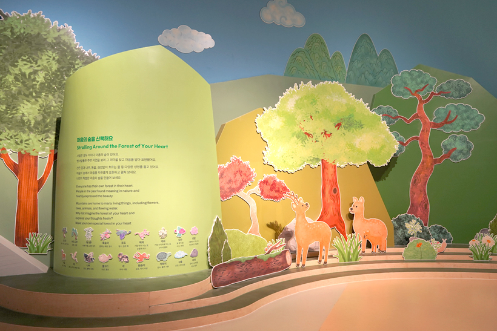
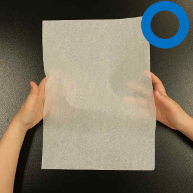

# 실제 사용 예시

실제 실행에서 저장된 이미지·입력·모델 출력을 함께 제시한다. `examples.json`에 각 사례의 실행 ID, 전처리 정보와 판정 기록이 있다. 아래는 모델의 판단 사례이며 Test 전체의 실제 정답을 뜻하지 않는다.

## 직접 실행

1. [환경 구성](../README.md)의 모델 다운로드와 런타임 빌드를 마친다.
2. 패키지 루트에서 `bash scripts/dashboard.sh`를 실행한다.
3. 실행 화면에서 **Frozen MD**, **Test**, **reviewed_guidelines**, 실행할 GPU와 문제 수를 선택하고 실행한다.
4. 완료된 문제의 이미지·alt·메타데이터, 최초 판정, 피드백, 재판정, 최종 오류 유형을 확인한다.
5. 전체 Test 완료 후 CSV 다운로드 버튼으로 `record_id,label` 형식의 제출 파일을 받는다.

대시보드를 쓰지 않을 경우:

```bash
python scripts/workflow.py --mode frozen --dataset test --limit 5 --gpu 0
```

[학습·추론 Notebook](../notebooks/01_ALTogether_학습과추론.ipynb)에서도 전처리와 저장된 실제 결과를 확인하고 GPU 추론을 실행할 수 있다. [최종 가이드라인 Notebook](../notebooks/02_최종_판정가이드라인.ipynb)은 실제 사용 문서 3개를 실행 없이 열람하는 용도다.

## Frozen: 피드백 없이 통과

실행 ID: `20261105_080500_5cf95c`


### 입력

```json
{
  "record_id": "r1f0f2535b5",
  "alt_text": "닫기",
  "page_title": "국립중앙박물관>누리집 소통망(SNS)",
  "context_text": "QR코드 현재 페이지의 QR코드 입니다. 주소복사 스크랩 인쇄 공유 X 페이스북",
  "in_link": true,
  "link_dest": "#"
}
```

### 저장된 모델 결과

- 최초 이진판정: **적절**
- 피드백 판단: **통과**
- 이후 이진판정: **적절**
- 최종 출력: **적절**

이미지가 링크 내의 'X' 아이콘으로, alt_text '닫기'가 이미지의 시각적 묘사가 아닌 기능적 목적(동작)을 정확히 설명하고 있어 가이드라인의 기능성 이미지 기준에 부합한다.

## Frozen: 피드백 후 재판정

실행 ID: `20261105_080500_5cf95c`



### 입력

```json
{
  "record_id": "r03e65b584e",
  "alt_text": "",
  "page_title": "어린이박물관>전시>상설 전시>마음을 이어요",
  "context_text": "이전 다음 위치 지도 내려받기",
  "in_link": false,
  "link_dest": ""
}
```

### 저장된 모델 결과

- 최초 이진판정: **적절**
- 피드백 판단: **피드백 제공**
- 이후 이진판정: **부적절**
- 최종 출력: **불충분형**

확인 대상: 전시 공간 현장 사진의 정보성 여부 / 현재 전달 근거: 내비게이션 텍스트 존재 및 장면 제시 목적 / 다시 대조할 점: 해당 이미지가 단순 장식인지, 아니면 전시물의 내용(텍스트 포함)과 공간 구성을 전달하는 정보성 이미지로서 고유한 시각 정보를 제공하는지 다시 확인하라.

## Train: 놓친 판단 기준을 피드백으로 생성

실행 ID: `20261017_031728_7a4451`



### 입력

```json
{
  "record_id": "r0005b6f560",
  "alt_text": "종이기록물 취급 안내(장갑 착용)",
  "page_title": "국가기록원>업무안내·자료>생산부터 보존까지>기록물 보존·복원",
  "context_text": "종이기록물은 깨끗한 손으로 조심스럽게 취급합니다\r\n핸드크림을 바른 손으로 취급하지 않습니다 #종이기록물#손#장갑",
  "in_link": true,
  "link_dest": "/next/common/archivedata/render.do?filePath=5C757046696c655C6470635C38663662636164332d613837322d346338332d613863312d6362"
}
```

### 저장된 모델 결과

- 최초 이진판정: **부적절**
- 피드백 판단: **피드백 제공**
- 이후 이진판정: **적절**
- 최종 출력: **적절**

인접 본문(context_text)이 이미지의 대상과 상황을 충분히 서술하고 있는 경우, 촬영 사진의 alt_text가 장면 묘사가 아닌 대상의 명칭이나 역할 표시 수준이어도 정보 손실이 없는 적절한 상태인지 다시 확인하라.

공개 Train 정답은 **적절**이다. Train에서는 공개 정답으로 실패를 식별하고 피드백을 만든다. 재판정 입력에는 정답 라벨을 직접 제공하지 않는다.

## 파일 구성

`examples.json`과 ID별 PNG는 실제 저장 결과이며 실행 Notebook에서도 읽는다. 발표 슬라이드로 만든 영상·장면 파일은 포함하지 않는다.
