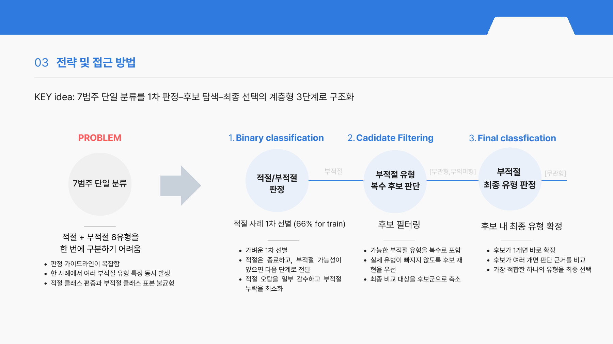
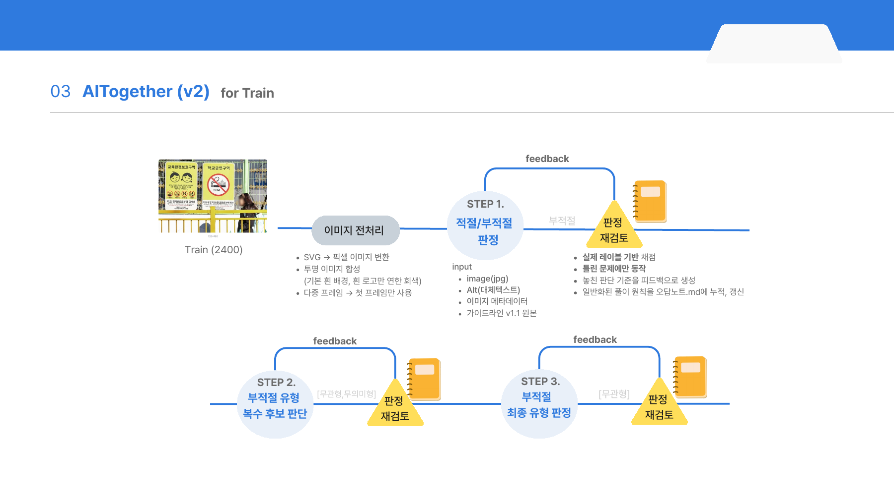
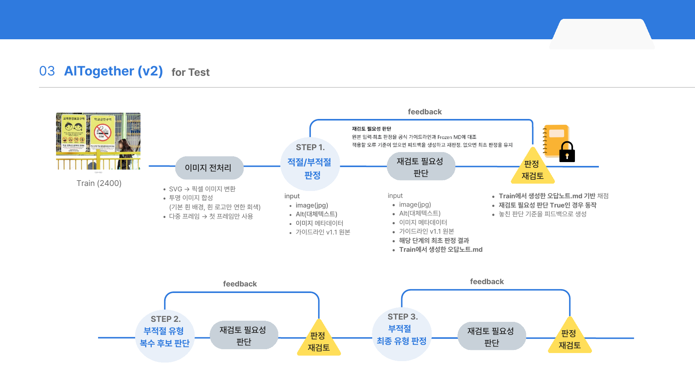

# ALTogether 문제해결 방법 설명서

**사례 기반 판정 가이드라인 생성과 계층형 추론을 결합한 한국어 대체텍스트 품질 판정**

## 1. 문제와 접근 방향

이 과제는 이미지, 대체텍스트, 페이지 문맥을 함께 보고 적절 또는 6개 부적절 유형 중 하나를 판정하는 문제다. 같은 문구도 이미지의 역할에 따라 판정이 달라진다. 예를 들어 ‘닫기’는 닫기 버튼을 설명하기에 충분하지만, 행사 포스터의 제목만 적은 문구는 일정·장소를 전달하지 못할 수 있다.

어려움은 두 가지였다. 첫째, 공식 가이드라인의 여러 조건이 한 사례에 동시에 해당할 수 있다. 둘째, **클래스 불균형이 크고 일부 오류 유형은 30건 미만이어서 충분한 학습 사례를 확보하기 어렵다.** 적절이 많은 데이터에서 전체 정확도만 높아져도 희소 오류 유형을 구분하는 문제는 남는다.

이에 Gemma 4 31B 기반 에이전트로 문제를 세 단계로 나누었다. 먼저 적절·부적절을 판단하고, 부적절한 경우 가능한 오류 유형을 넓게 모은 다음, 후보별 근거를 비교해 하나를 선택한다. 각 단계에서 틀린 이유를 정리해 **문제 풀이 방법을 가이드라인으로 학습**한다. 모델 가중치를 추가 학습하지 않고, 사례에서 놓친 판단 기준을 문서에 누적하는 방식이다.

발표자료에서는 이 문서를 ‘오답노트’라고 설명했다. 개별 문제의 정답을 적어 두는 대신, 다른 문제에도 적용할 확인 항목과 예외 조건을 남긴다. 자동 생성한 초안은 반복 비교 실험과 인간 검토를 거쳐 수정하고, 최종 선택한 문서만 실제 사용에 적용한다. 공식 기준에서 짧게 설명된 조건을 실제 이미지와 문맥에 어떻게 적용할지 구체화하는 것이 목적이다.

## 2. 활용 데이터와 입력 구성

- 대회 공식 KoAltQ Train 2,400건: 원본 이미지, 공개 7범주 정답, alt 및 페이지 메타데이터.
- 공식 Test 600건: 동일 입력 형식이며 전체 정답은 비공개.
- 경계사례 자료의 공개 Test 109건: 주최 측이 학습·후처리·제출 활용을 허용한 공개분. `데이터셋_라벨`을 사용하며 별도의 재검토 의견 열과 혼동하지 않는다.
- 공식 `라벨링-가이드라인-v1.1.md`: 판정에 필요한 1~3절과 판정 범위에 관한 5절 원문을 프롬프트에 포함한다. 4절은 사람의 검수 절차를 다루는 자료로 문서에 보존하되 모델의 유형 판정 지시문과 구분한다.

모델 입력은 원본 이미지와 `alt_text`, `page_title`, `context_text`, `in_link`, `link_dest`, `heading_path`, `kogl_marker`다. `link_dest`는 이름과 달리 이 데이터에서 **링크의 표시 문구**를 뜻한다. URL 형태의 값도 존재하므로 이를 실제 설명 문구와 구분한다. 페이지 제목·헤딩이 존재한다는 이유만으로 이미지에만 있는 정보를 이미 전달한 것으로 간주하지 않도록 사례 기반 기준을 보완했다.

전처리는 SVG의 원래 크기 래스터화, 첫 프레임 선택, 알파 합성이다. 기본 흰 배경에서 흰 전경이 소실되는 경우에만 밝은 회색 `#E0E0E0`을 사용한다. 모델에 전달한 PNG와 전처리 정보를 별도 저장해 원본과 비교할 수 있다.

## 3. 모델 개발 방법

### 3.1 모델과 에이전트 구성

Gemma 4 31B IT의 IQ4_NL GGUF와 BF16 비전 projector를 llama.cpp에서 구동한다. 판정, 피드백 생성, 문서 갱신의 역할을 분리하고 요청 입력과 출력을 JSON 계약으로 관리한다. 별도 피드백 세션은 최초 결론을 그대로 반복하는 대신 기준의 적용 조건을 재검토한다. 재판정에는 원본 이미지와 메타데이터를 다시 제공한다. 요청은 저장된 메시지로 구성하며 `cache_prompt=False`여서 KV 캐시에 남은 내용에 의존하는 설계가 아니다.

추가 모델 가중치 학습은 수행하지 않는다. 개선 대상은 **판단 기준 문서, 판단 단계의 연결, 명확한 입력 구조에 대한 게이트**다. 모델 파일과 단계별 문서를 분리하므로 사람이 문서를 수정해 비교 실험하기 쉽다.

### 3.2 전처리 이후의 우선 분기

| 입력 조건 | 처리 | 판단 근거 및 경계 |
|---|---|---|
| `alt.strip()==''`, `in_link=True`, `link_dest`가 비거나 URL·경로 형태 | 부적절 구조 게이트 | 이미지 설명과 읽을 수 있는 링크 목적 설명이 없음 |
| 빈 alt + 링크 안 + 비어 있지 않은 일반 문구 | 멀티모달 예외 검사 | 문구가 있다는 사실만으로 적절을 확정하지 않고, 이미지 고유의 핵심 정보 누락을 확인 |
| 같은 링크 표시 문구 안에 정규화된 비어 있지 않은 alt가 포함 | 중복 구조 게이트로 이진 부적절 처리 | 접미 표현·공백 등 코드에 정한 정규화 후 비교. 이후 유형 후보·최종 판정으로 연결 |
| 장식 가능성이 있는 이미지 | 별도의 구조화된 시각 검토 | 로고·아이콘이라는 형태만으로 장식을 확정하지 않음. 정보·기능 역할 및 추가 정보 여부를 확인한 경우 장식오용형 확정 |

마지막 행은 정규식만으로 결정되는 규칙이 아니라 **멀티모달 판단을 사용하는 전용 분기**다. 확정되지 않은 사례는 기본 파이프라인으로 돌아간다. 모든 구조 게이트의 조건과 출력을 저장하여 어느 분기가 최종 결과에 영향을 주었는지 확인할 수 있다.

### 3.3 계층형 3단계 판정

*참가팀 발표자료 7쪽. 적절한 사례는 앞 단계에서 마치고, 부적절한 사례는 복수 후보 탐색과 최종 선택으로 이어진다.*

**1단계: 적절·부적절 이진판정.** 공식 기준과 이미지·alt·메타데이터를 대조한다. 링크 이미지에서는 목적지·동작의 전달 여부, 정보성 이미지에서는 핵심 대상·상태·문구의 누락 또는 왜곡, 빈 alt에서는 주변 문맥이 시각 정보를 실제로 대신 전달하는지를 확인한다. 출력에는 결론뿐 아니라 이미지 근거와 문맥 근거를 남긴다.

**2단계: 부적절 유형 후보를 넓게 탐색.** 부적절한 경우 파일명형·무관형·무의미형·장식오용형·중복형·불충분형을 각각 검토한다. 정답 후보를 너무 일찍 제거하지 않도록 복수 후보를 허용하고, 후보 재검토 결과는 기존 후보와 합집합으로 결합한다. 이 단계의 평가는 F1 대신 **정답 유형이 후보 집합에 들어 있는 비율**이다.

**3단계: 고정 후보 안에서 최종 선택.** 원본 입력과 후보별 근거를 대조하여 하나를 선택한다. 후보가 하나면 추가 모델 호출 없이 확정한다. 복수 후보이면 공식 정의와 우선순위를 고려하되, 후보에 넣었다는 사실만으로 해당 오류가 확정되었다고 해석하지 않는다. JSON 스키마와 후처리 검증으로 후보 밖의 유형을 선택하지 못하도록 한다.

이진 피드백을 후보·최종 단계에 무조건 전달하지 않는다. 이진, 후보, 최종 선택이 서로 다른 실패 원인을 갖기 때문에 **각 단계의 가이드라인을 별도로 축적**한다.

### 3.4 Train: 사례에서 가이드라인 만들기

*참가팀 발표자료 10쪽. 판정과 피드백·문서 갱신을 단계별로 분리한다.*

Train의 정답은 시스템이 다음 조건을 판별하고 피드백을 만드는 데 사용한다.

| 단계 | 피드백·재판정·문서 갱신 조건 | 제외되는 경우 |
|---|---|---|
| 이진 | 최초 적절/부적절이 공개 정답의 이진값과 다름 | 이미 맞춘 이진판정 및 확정 구조 게이트 |
| 후보 | 실제 부적절 유형이 최초 후보에 없음 | 정답 후보가 이미 있거나 실제 라벨이 적절 |
| 최종 | 실제 부적절 유형이 후보 안에 있고 최초 선택이 틀림 | 정답 후보가 없거나 이미 정답을 선택 |

한 사례의 처리는 다음과 같다.

1. 판정 에이전트가 원본 입력과 공식 기준을 바탕으로 최초 결과를 낸다.
2. 시스템이 공개 정답과 비교해 해당 단계의 실패 여부를 식별한다.
3. 별도 피드백 에이전트가 **원본 입력 + 최초 판단 + 공개 정답 + 공식 기준 + 해당 단계의 현재 MD**를 검토한다. 정답을 복사해 주는 대신, 놓친 비교 조건을 다시 확인하도록 짧게 안내한다.
4. 판정 에이전트가 원래 입력·최초 판단·피드백을 받아 재판정한다. 정답 레이블 자체는 이 재판정 입력에서 제외한다.
5. 문서 갱신 에이전트는 **기존 MD + 새 피드백**으로 문서를 갱신한다. 재판정 결과를 정답으로 간주하여 문서에 덧붙이는 방식이 아니다. 문서 갱신과 재판정은 피드백 생성 이후 별도 작업으로 처리할 수 있다.
6. 문서가 길어지면 조건·예외를 보존하면서 중복을 합치는 별도 프롬프트를 사용한다. 유효한 문서만 원자적으로 반영하며, 실패하면 이전 문서를 보존한다. 문서 갱신 실패가 해당 사례의 정상 판정 결과 저장까지 막지 않도록 한다.

축적되는 문서는 문제 ID별 정답 목록이 아니라 **언제 무엇을 대조해야 하는가**를 담은 판단 지침이다. 다만 문서에 적힌 기준도 오류·과잉 일반화를 포함할 수 있으므로 사람의 검토와 반복 평가가 필요하다.

### 3.5 비교 실험과 인간 검토

자동 생성한 문서는 곧바로 운영 기준으로 승격하지 않는다. 반복 실패 패턴이 있는 사례를 원본 이미지와 메타데이터로 대조하고, 공식 기준과 충돌하는 표현·과도한 일반화·단일 사례에만 맞는 예외를 점검한다. 단계별로 변경 전후를 비교하면서 다음을 확인한다.

- 오답을 정답으로 바꾼 사례와 정답을 오답으로 바꾼 사례를 함께 확인한다.
- 한 유형의 개선이 다른 유형의 오탐 증가로 이어지는지 유형별로 확인한다.
- 소수 사례 실험 후 더 넓은 문제 범위에서 기존 성능이 유지되는지 점검한다.
- 사람이 기준을 추가·삭제·수정하고 채택 또는 보류를 결정한다.

제출한 최종 문서는 이 과정을 거쳐 선정한 버전이다. **AI가 생성한 기준을 사람이 읽고 고치며, 변경 전후의 효과를 비교할 수 있다는 점**을 중요하게 보았다. 여러 차례의 비교·교차 검토를 수행했으며, 이는 독립적인 K-fold 교차검증과는 구분한다.

실제 사용한 세 문서 전문은 [최종 가이드라인 Notebook](../notebooks/02_최종_판정가이드라인.ipynb)에 넣었다. 실행하지 않고도 읽을 수 있으며, 원본 MD와 SHA-256을 함께 제시한다.

### 3.6 Frozen: 검토한 가이드라인으로 실제 판정하기

*참가팀 발표자료 11쪽. 그림의 `Train (2400)`은 발표 당시 학습 자료를 정답 없이 다시 푼 실험을 뜻한다. 같은 Frozen 절차를 실제 사용에서는 Test 600건에 적용한다. 그림의 ‘MD 기반 채점’은 정답과의 점수 계산이 아니라 가이드라인을 이용한 판정 재검토를 의미한다.*

실제 사용에서는 정답 대신 Train과 인간 검토를 거쳐 선정한 MD를 사용한다. 최초 판정 후 피드백 에이전트가 **공식 기준 + 고정 MD + 원본 입력 + 최초 결과**를 대조하여 `통과` 또는 `피드백 제공`을 고른다. 통과한 사례는 재판정하지 않는다. 피드백이 필요한 사례만 다시 검토한다.

이진 재판정은 새 피드백과 고정 이진 MD를 함께 활용한다. 후보·최종 재판정은 해당 단계 피드백을 사용하며, 후보의 합집합 유지와 고정 후보 내 최종 선택 제약을 지킨다. 세 MD는 실행 시작 시 사본과 해시를 저장하고 추론 중 수정하지 않는다. 학습 자료에 포함된 정답도 Frozen 모델 요청으로 전달하지 않는다.

새 데이터나 공식 기준 개정이 생기면 기존 운영 문서를 보존한 채 검토용 사본에서 추가 Train·사례 검토·회귀 평가를 수행할 수 있다. 이는 변경에 대응할 수 있는 **운영 절차**이며, 모든 새로운 도메인에서 성능이 자동으로 유지된다는 보장은 아니다.

## 4. 실험 및 평가

### 4.1 실패가 생기는 단계를 나누어 측정한다

- **후보 생성 전 이진 F1:** 부적절 탐지 자체가 실패했는지 확인.
- **후보 정답 포함률:** 정답 유형이 최종 선택 전에 사라졌는지 확인.
- **후보 안에 정답이 있을 때 최종 선택 정확도:** 선택 에이전트의 구별 능력 확인.
- **최종 7범주 macro-F1:** 희소 유형을 포함해 유형별 F1을 동일 가중 평균.
- **최종 라벨을 이진으로 합친 F1:** 뒤 단계의 변경까지 반영한 최종 부적절 탐지 성능.
- **종합 점수:** 이진 F1과 7범주 macro-F1을 0.5씩 합산.

이진 F1은 부적절을 양성으로 두며 `2TP/(2TP+FP+FN)`이다. 유형별 표의 표본 수는 해당 정답 유형의 전체 개수, 맞춘 수는 그 유형으로 정확히 예측한 개수이며, F1은 정밀도와 재현율을 함께 반영한다.

### 4.2 확인한 성적

| 자료 / 평가 성격 | n | 이진 F1 | 7범주 macro-F1 | 종합 |
|---|---:|---:|---:|---:|
| 공식 제로샷 기준선, 공식 문서 | 584 | 0.7470 | 0.6310 | 0.6890 |
| ALTogether 대회 제출, 참가자 전달 채점값 | 600 | 0.8265 | 0.7035 | 0.7650 |
| 이전 Frozen 검증 실행의 Train 재평가 | 2,400 | 0.8165 | 0.7385 | 0.7775 |

Train 표는 `20261028_061912_ce10a3`의 저장 결과이며 최종 Test 제출 실행과 다른 버전이다. 문서 선정 과정에서의 검증 기록으로 제공하며 최종 제출 모델의 미실시 Train 성능을 대신 주장하지 않는다. Notebook에서 공식 Train 정답과 저장 출력을 다시 대조할 수 있다.

공개 109건은 학습에 사용 가능한 경계 사례이며 균등 표집된 독립 평가셋이 아니다. 해당 결과는 원본 모델 출력 기준으로 별도 계산하고, 공개 정답을 제출 CSV에 적용하는 후처리 성능과 분리한다. 공식 평가의 전체 비공개 정답은 보유하지 않으므로 대회 채점값은 참가자가 전달한 수치로 기록한다.

### 4.3 대안과 실패를 반영한 선택

모든 문제에 무조건 재검토를 적용하면 이미 맞춘 판정을 바꾸는 부작용이 발생했다. 이에 Train은 실패한 단계에 집중하고, Frozen은 재검토 필요성을 먼저 판단하도록 했다. 적절로 나온 결과를 반복해서 독립 재판정하는 추가 단계도 일관된 이득이 없어 최종 핵심 흐름에서 제외했다.

후보를 좁히는 재검토는 실제 정답을 제거할 수 있어 넓은 후보 탐색과 합집합 유지로 바꾸었다. 반대로 후보를 넓게 만든 뒤 우선순위만 기계적으로 적용하면 약한 후보가 최종 결과를 차지할 수 있으므로 근거를 비교하는 선택 단계를 유지했다. 가이드라인 개정 후에는 빈 alt의 읽을 수 있는 링크 문구를 무조건 적절로 처리하던 조건을 시각 예외 검사로 변경했다.

## 5. 예상 결과물과 활용

결과물은 품질 판정 코드와 7범주 예측 CSV, 단계별 판정 가이드라인 3개, 판정 근거와 피드백을 확인하는 대시보드다. Notebook에서 데이터와 전처리, Train의 문서 생성, Frozen 추론, 저장된 결과의 평가를 순서대로 확인할 수 있다.

현장에서 판정에 이견이 생기면 담당자가 원본 이미지·문맥, 모델의 근거, 적용한 문서를 나란히 확인할 수 있다. 기준이 지나치게 넓거나 예외가 빠졌다면 문구를 고치고 같은 사례를 다시 평가할 수 있다. 경계 사례를 검토한 경험이 특정 담당자에게만 남지 않고 다음 점검에 사용할 문서로 남는다.

새 데이터나 지침 개정에도 기존 문서에서 추가 Train을 시작할 수 있다. 문서를 수정한 뒤 기존 사례의 성능이 유지되는지 비교하고, 검토를 마친 버전을 배포한다. 문제가 생기면 이전 문서로 되돌릴 수 있다. 이처럼 **기준의 생성·검토·적용을 분리한 점**이 운영 환경에서 사람과 협업하기 위한 설계다.

추론은 로컬에서 수행하므로 외부 상용 API 없이 공공 웹사이트의 대체텍스트 점검에 활용할 수 있다. 다만 시각 인식 오류와 모호한 경계 사례는 남아 있다. 근거와 문서를 제공하는 것은 담당자의 검토를 돕기 위한 것이며, 새로운 환경에서도 성능이 유지되는지는 별도 확인해야 한다.

## 6. 참고한 접근

발표자료에서 소개한 다음 연구를 참고해, 피드백을 통한 재판정과 경험의 문서화를 과제에 맞게 구성했다. 각 연구의 구현을 그대로 재현한 것은 아니다.

- [MemPrompt — Memory-assisted prompt editing to improve GPT-3 after deployment (EMNLP 2022)](https://aclanthology.org/2022.emnlp-main.183/): 피드백을 저장하고 이후 문제에 활용하는 접근.
- [MetaReflection: Learning Instructions for Language Agents using Past Reflections (EMNLP 2024)](https://aclanthology.org/2024.emnlp-main.477/): 이전의 반성에서 재사용할 지침을 만드는 접근.
- [Self-Refine: Iterative Refinement with Self-Feedback (NeurIPS 2023)](https://proceedings.neurips.cc/paper_files/paper/2023/hash/91edff07232fb1b55a505a9e9f6c0ff3-Abstract-Conference.html): 최초 출력, 피드백, 재수정으로 이어지는 절차.
